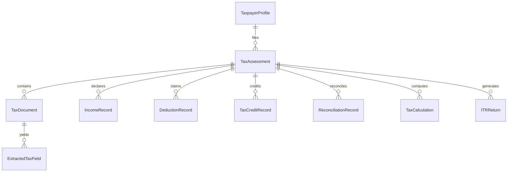

# Phase 1: Architecture and Tax Data Model
**Project:** Indian Income Tax Return (ITR-1 SAHAJ) Preparation System  
**Module:** `tax_module`  
**Date:** November 2026  
**Status:** Completed & Tested (11 unit tests passed, 209 total regression tests passing)

---

## 1. Architectural Overview

The **Indian Income Tax Return Preparation Module** extends the existing Multimodal Document AI platform as an isolated, modular sub-package (`tax_module/`). It establishes an auditable, end-to-end data pipeline from document ingestion through official ITR-1 JSON generation:

```
                  ┌────────────────────────────────────────┐
                  │       Taxpayer Onboarding / UI        │
                  │ (PAN, Bio, Bank, AY Selection)         │
                  └──────────────────┬─────────────────────┘
                                     │
                                     ▼
                  ┌────────────────────────────────────────┐
                  │      Tax Document Ingestion & OCR      │
                  │ (Form 16, AIS/TIS, 26AS, Interest Cert)│
                  └──────────────────┬─────────────────────┘
                                     │
                                     ▼
                  ┌────────────────────────────────────────┐
                  │     Field Extraction & Normalization   │
                  │   (Decimal Precision, Human Review)    │
                  └──────────────────┬─────────────────────┘
                                     │
                                     ▼
                  ┌────────────────────────────────────────┐
                  │    Income Reconciliation & Matching    │
                  │ (Form 16 vs 26AS vs Bank Certificates) │
                  └──────────────────┬─────────────────────┘
                                     │
                                     ▼
                  ┌────────────────────────────────────────┐
                  │      Deterministic Tax Computation     │
                  │  (Old vs New Regime, 87A, Slabs, Cess) │
                  └──────────────────┬─────────────────────┘
                                     │
                                     ▼
                  ┌────────────────────────────────────────┐
                  │   Official ITR-1 JSON Generator        │
                  │   (Schema Validation, Utility Export)  │
                  └────────────────────────────────────────┘
```

---

## 2. Entity-Relationship Model



---

## 3. Core Data Structures & Models (`tax_module/models.py`)

All financial quantities are strictly modeled with **Python `Decimal`**:
- `TaxpayerProfile`: Master taxpayer identity (validated PAN regex `^[A-Z]{5}[0-9]{4}[A-Z]{1}$`, residential status, address, bank accounts for refund credit, PAN masking).
- `TaxAssessment`: Assessment filing session bound to an Assessment Year (e.g. `2024-25` for FY `2023-24`), tracking the 14-stage filing lifecycle status from `NOT_STARTED` to `VERIFIED`.
- `TaxDocument`: Metadata, SHA-256 hash, and OCR extraction payload for tax documents.
- `ExtractedTaxField`: Individual extracted fields preserving exact OCR string, normalized `Decimal`, confidence, bounding box coordinates, and user corrections.
- `IncomeRecord`: Categorized income heads (`SALARY`, `HOUSE_PROPERTY`, `OTHER_SOURCES`) with gross, exempt allowances, and net taxable amounts.
- `DeductionRecord`: Chapter VI-A deductions (`80C`, `80D`, `80TTA`, `80CCD_1B`, `80G`).
- `TaxCreditRecord`: Prepaid tax components (TDS from Salary, TDS Other, Advance Tax, Self-Assessment Tax) with deductor TAN and challan details.
- `ReconciliationRecord`: Cross-source discrepancy audit records (e.g., Form 16 salary vs 26AS TDS vs AIS).
- `TaxCalculation`: Complete breakdown of taxable income, rebate u/s 87A, surcharge, 4% Health & Education cess, and refund/payable amount.
- `ITRReturn`: Generated official JSON artifact, schema version, and validation outcome.
- `TaxAuditEvent`: Immutable log recording all state transitions and user corrections.

---

## 4. SQLite Persistence & Isolation (`tax_module/db.py`)

- **Database File:** `data/tax_system.db` (Isolated from existing `data/financial_documents.db` to prevent collision with Phase 11 tables).
- **Foreign Key Constraints:** Enabled on every connection (`PRAGMA foreign_keys = ON;`) with cascading deletes where appropriate.
- **Monetary Precision Guarantee:** Financial columns (`gross_amount`, `claimed_amount`, `normalized_decimal`, etc.) are serialized as exact Decimal string representations in SQLite, preventing binary floating-point roundoff issues.
- **Multi-Taxpayer Isolation:** All queries for assessments, documents, extracted fields, income, and calculations require an explicit `assessment_id` or `taxpayer_id` scope.

---

## 5. Verification & Test Coverage

- **Suite:** `tests/test_tax_models.py`
- **Result:** 11 passed in 0.73s
- **Coverage Areas:**
  - Financial Year / Assessment Year reciprocal mapping (`2024-25` ↔ `2023-24`)
  - PAN and Bank Account masking
  - PAN format validation
  - Decimal serialization roundtrip without precision loss
  - Taxpayer CRUD and profile updates
  - Assessment lifecycle status transitions and audit logging
  - Document & extracted field user correction overrides
  - Income, deduction, credit, tax calculation, and ITR return persistence
  - Multi-taxpayer data isolation
