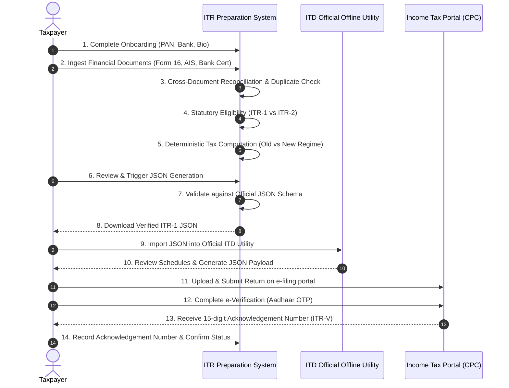

# Phase 10: Official Offline Utility Filing Workflow & State Machine
**Project:** Indian Income Tax Return (ITR-1 SAHAJ) Preparation System  
**Module:** `tax_module`  
**Date:** November 2026  
**Status:** Completed & Tested

---

## 1. Supported Filing Workflow (Official Offline Handoff)

The application adheres strictly to the official **Offline Utility Handoff** mechanism established by the Income Tax Department of India (ITD). 

> [!IMPORTANT]
> **No Direct/Automated Credential Filing:** The system never asks for or stores taxpayer e-filing portal passwords or OTPs, which would breach ITD security terms. Instead, it generates a validated, schema-compliant JSON return file ready to import into the official Income Tax Department offline utility.

### Step-by-Step Filing Journey

---

## 2. Statutory Filing Lifecycle State Machine

The session moves deterministically through 14 explicit states defined in `FilingStatus`:

1. `NOT_STARTED`: Onboarding initialized; waiting for document uploads.
2. `DOCUMENTS_UPLOADED`: Documents ingested and hashed (SHA-256).
3. `EXTRACTION_IN_PROGRESS`: OCR text extraction and field normalization.
4. `AWAITING_USER_REVIEW`: Extracted financial fields awaiting taxpayer verification.
5. `RECONCILIATION_REQUIRED`: Cross-source discrepancy flags detected requiring review.
6. `TAX_CALCULATED`: Deterministic tax computation executed for Old and New regimes.
7. `ITR_VALIDATION_PENDING`: Candidate return constructed; awaiting schema validation.
8. `ITR_READY`: Return schedules verified; ready for JSON serialization.
9. `JSON_GENERATED`: Validated official JSON produced and downloaded.
10. `IMPORTED_IN_OFFICIAL_UTILITY`: Taxpayer confirmed import into official offline utility.
11. `SUBMITTED_BY_TAXPAYER`: Taxpayer confirmed submission on e-filing portal with acknowledgement number.
12. `VERIFICATION_PENDING`: Return submitted; awaiting Aadhaar OTP e-verification.
13. `VERIFIED`: Return e-verified and CPC acknowledgement confirmed.
14. `REJECTED_OR_CORRECTION_REQUIRED`: CPC defect notice or user correction required.
