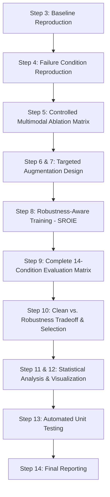

# Phase 9: Robustness-Aware Model Improvement & Multimodal Ablation — Implementation Plan

**Project**: Multimodal Transformer-Based Intelligent Document Understanding and Information Extraction  
**Phase**: Phase 9  
**Status**: PROPOSED & PENDING APPROVAL  

---

## 1. Executive Summary & Objective

In Phase 8, comprehensive stress evaluation revealed critical operational vulnerabilities in the validated LayoutLMv3 models:
1. **Severe Layout Jitter Sensitivity**: $\pm 10\%$ bounding-box jitter degraded FUNSD Macro F1 by **65.4%** ($0.7179 \rightarrow 0.2487$) and SROIE Macro F1 by **23.5%** ($0.8784 \rightarrow 0.6716$), with the SROIE `COMPANY` entity dropping by **44.8%** ($0.9049 \rightarrow 0.5000$).
2. **Missing Text Sensitivity**: 20% token masking reduced SROIE Macro F1 to $0.7087$ (with `ADDRESS` collapsing from $0.8434 \rightarrow 0.6087$).
3. **Modality Hierarchy Disconnect**: Gaussian image blur caused negligible degradation ($\le 1.3\%$ drop across all benchmarks), raising the fundamental scientific question of whether the visual modality actually contributes to task performance or is merely bypassed.

**Phase 9 Objectives**:
- **Disentangle Modality Contributions**: Conduct a controlled 7-condition multimodal ablation study to measure the true functional contribution of Text, Layout, and Image modalities.
- **Investigate Root Causes**: Determine whether layout vulnerability stems from absolute 2D coordinate embeddings, token-layout cross-alignment disruption, or training distribution narrowness.
- **Robustness-Aware Model Improvement**: Implement targeted layout coordinate augmentation, OCR/text noise injection, and joint training pipelines that improve stress resilience while strictly guarding against clean-test degradation.
- **Tradeoff Optimization**: Establish a formal, predefined multi-objective selection criterion to identify the Pareto-optimal model for deployment.
- **Strict Scientific Integrity**: Ensure all original checkpoints, datasets, and Phase 6–8 artifacts remain 100% unaltered.

---

## 2. Technical Inspection Findings (Step 1 Verification)

| Architectural Element | Actual Implementation | Modality Impact |
|---|---|---|
| **Underlying Model** | `LayoutLMv3ForTokenClassification` (`microsoft/layoutlmv3-base`) | 12-layer multimodal transformer with 125M parameters. |
| **Text Pathway** | Byte-Pair Encoded (BPE) subwords aligned via `align_labels_to_tokens`. First subword receives label; continuation tokens receive `-100`. | Essential semantic backbone. Vulnerable to subword tokenization shifts under character typos. |
| **Layout Pathway** | Bounding boxes $[x_0, y_0, x_1, y_1]$ normalized to $[0, 1000]$ integer range. 2D spatial embeddings added to token embeddings. | Highly rigid spatial priors. Jitter breaks alignment between prompt and answer boxes. |
| **Image Pathway** | `pixel_values` ($3 \times 224 \times 224$) processed into visual patches ($14 \times 14$ patches of size $16 \times 16$) projected linearly and concatenated. | Patches provide weak semantic localization; robust to blur because low-frequency layout shapes survive blur. |
| **Multimodal Fusion** | Early/intermediate full self-attention across combined text tokens and visual patch tokens across all 12 transformer layers. | Cross-attention allows text and layout to dominate; ablation will isolate exact cross-modal dependencies. |
| **Baseline Checkpoints** | SROIE: `models/checkpoints/layoutlmv3/sroie/corrected/best/`<br>FUNSD: `models/checkpoints/layoutlmv3/funsd/full/`<br>CORD: `models/checkpoints/layoutlmv3/cord/full/` | Validated baselines yielding 0.8785 (SROIE), 0.7179 (FUNSD), 0.9733 (CORD). |

---

## 3. Detailed Experimental Roadmap



---

## 4. Phase-by-Phase Implementation Specifications

### Step 3: Clean Baseline Verification
- Validate unperturbed test splits on all three benchmarks:
  - SROIE: $0.8784 \pm 0.0020$ (Target: $0.8785$)
  - FUNSD: $0.7179 \pm 0.0020$ (Target: $0.7179$)
  - CORD: $0.9733 \pm 0.0020$ (Target: $0.9733$)
- **Gate**: If any baseline deviates beyond established tolerance, halt and diagnose before training any new models.

### Step 4: Phase 8 Failure Mode Reproduction
- Run the 5 core stress conditions against the baseline models:
  1. Layout Jitter $\pm 10\%$
  2. Missing Text (20% Masking)
  3. OCR Noise (20% Character Confusion)
  4. Image Blur ($\sigma=3.5$)
  5. Composite Stress (OCR 10% + Layout $\pm 5\%$ + Blur $\sigma=1.5$)
- Confirm consistency with Phase 8 reported deltas.

### Step 5: Controlled Multimodal Ablation Study
Evaluate the 7 standardized modality configurations across SROIE, FUNSD, and CORD under both Clean and Stressed conditions:

| ID | Modality Configuration | Input Manipulation | Scientific Goal |
|---|---|---|---|
| **A** | **Full Multimodal** | Text + Layout + Image (All Active) | Benchmark baseline. |
| **B** | **Text Only** | Text active; BBox $\rightarrow [0,0,0,0]$; Pixel values $\rightarrow \mathbf{0}$ | Measure purely lexical semantic capacity. |
| **C / F** | **Text + Layout (No-Image)** | Text active; BBox active; Pixel values $\rightarrow \mathbf{0}$ | Isolate exact performance loss when vision is removed. |
| **D / G** | **Text + Image (No-Layout)** | Text active; BBox $\rightarrow [0,0,0,0]$; Pixel values active | Measure whether vision compensates for absent layout. |
| **E** | **Layout + Image (No-Text)** | Text replaced with `[MASK]` tokens; BBox active; Pixel values active | Measure purely visual-spatial extraction capacity without text. |

*Critical Scientific Distinction*: Differentiate *modality contribution* (difference between Full and ablated model on clean data) from *robustness to corruption* (rate of performance drop under noise).

### Step 6 & 7: Layout and OCR Robustness Augmentation Engines
Develop dedicated augmentation transforms for the training pipeline:
1. **Dynamic Layout Jitter Augmentation** (`LayoutJitterAugmentation`):
   - Adds uniform coordinate shifts $\delta_x, \delta_y \sim \mathcal{U}(-\alpha, +\alpha)$ to normalized coordinates, clamped to $[0, 1000]$ with invariant positive area ($x_0 < x_1, y_0 < y_1$).
   - Multi-scale training jitter: $\alpha \in [0.02, 0.08]$ with probability $p=0.5$.
2. **Dynamic OCR & Text Masking Augmentation** (`TextNoiseAugmentation`):
   - Character substitution using OCR confusion dictionary (e.g. `O` $\leftrightarrow$ `0`, `l` $\leftrightarrow$ `1`, `S` $\leftrightarrow$ `5`) at rate $p=0.08$.
   - Typographical noise (random deletion, insertion, adjacent swap) at rate $p=0.04$.
   - Random word token masking (`***`) at rate $p=0.05$.
3. **Immutability Guarantee**: Augmentation transforms work strictly on in-memory batch copies. Disk datasets are never modified.

### Step 8: Robustness-Aware Training Pipelines
Train separate candidate models on SROIE (the benchmark with verified per-entity failure data):
- **Model 1 (`sroie_baseline_repro`)**: Re-trained clean baseline with fixed seed (Seed 42).
- **Model 2 (`sroie_layout_aug`)**: Trained with Dynamic Layout Jitter Augmentation.
- **Model 3 (`sroie_ocr_aug`)**: Trained with Dynamic OCR / Text Noise Augmentation.
- **Model 4 (`sroie_joint_aug`)**: Trained with joint Layout + Text Augmentation.

**Hyperparameters & Safeguards**:
- Base: `microsoft/layoutlmv3-base`, lr: `5e-5`, batch: 2, grad_accum: 4 (effective batch 8), fp16: `True`, cosine decay with 10% warmup, 10 epochs.
- Validation checkpoint selection based on validation Macro F1.
- Stored exclusively in `models/checkpoints/phase9/sroie/...` (zero risk of overwriting existing checkpoints).

### Step 9: Comprehensive 14-Condition Evaluation Matrix
Every candidate model is evaluated across all 14 Phase 8 conditions:
- Clean
- OCR Noise: 5%, 10%, 20%
- Missing Text: 5%, 10%, 20%
- Layout Jitter: $\pm 2\%$, $\pm 5\%$, $\pm 10\%$
- Image Blur: $\sigma=1.0, 2.0, 3.5$
- Composite Stress

### Step 10: Clean vs. Robustness Tradeoff & Model Selection Criteria
Predefined multi-objective selection formula:
$$\text{Score}(M) = 0.40 \cdot \text{F1}_{\text{clean}} + 0.30 \cdot \text{F1}_{\text{avg\_stress}} + 0.30 \cdot \text{F1}_{\text{worst\_stress}} - \lambda \cdot \max(0, \text{F1}_{\text{clean\_baseline}} - \text{F1}_{\text{clean}})$$
where $\lambda = 2.0$ to heavily penalize clean performance regressions $> 1.0\%$.

### Step 11 & 12: Statistical Validation & Visualizations
- Compute paired t-tests and Wilcoxon signed-rank tests across document-level F1 scores.
- Generate high-resolution plots under `reports/phase9/visualizations/`:
  1. Multimodal ablation comparison across benchmarks.
  2. Layout jitter sensitivity curves before vs. after augmentation.
  3. OCR corruption sensitivity curves before vs. after augmentation.
  4. Pareto tradeoff frontier (Clean F1 vs. Worst-Case F1).
  5. SROIE per-entity improvement breakdown (`COMPANY`, `ADDRESS`, `TOTAL`, `DATE`).
  6. Side-by-side visual examples of repaired predictions under stress.

### Step 13: Automated Unit Testing Suite
Create `tests/test_phase9_robustness_improvement.py` with test coverage for:
- Dataset and checkpoint immutability.
- Deterministic vs. random seed perturbation behavior.
- Coordinate validity under extreme jitter.
- Modality zeroing and masking mechanics.
- Numerical evaluation stability and score range sanity.

### Step 14: Comprehensive Final Reporting
Export all required summary CSVs and the formal Markdown report:
- `reports/phase9_ablation_results.csv`
- `reports/phase9_robustness_results.csv`
- `reports/phase9_entity_results.csv`
- `reports/phase9_model_comparison.csv`
- `reports/phase9_robustness_improvement_report.md`

---

## 5. Verification Plan

### Automated Tests
```powershell
& "c:\MDA\multimodal-document-ai\.venv312\Scripts\pytest.exe" tests/test_phase9_robustness_improvement.py -v
```

### Full Regression Test
```powershell
& "c:\MDA\multimodal-document-ai\.venv312\Scripts\pytest.exe" tests/test_phase6_unified_eval.py tests/test_phase7_error_analysis.py tests/test_phase8_robustness.py tests/test_phase9_robustness_improvement.py -v
```

### Manual & Checkpoint Verification
- Verify checksums / hashes on `models/checkpoints/layoutlmv3/sroie/corrected/best/pytorch_model.bin` to prove original checkpoint was never touched.
- Verify line count and MD5 on `processed_data/sroie_corrected/test.jsonl` to prove zero disk modification.

---

## 6. User Review Required

> [!IMPORTANT]
> **GPU Training Resource Confirmation**: Robustness-aware training involves running 3-4 targeted training runs on SROIE (10 epochs each on 533 samples, ~2-3 minutes per run on the NVIDIA RTX 3060 Laptop GPU). This will produce 3 new checkpoints safely isolated under `models/checkpoints/phase9/`.

> [!IMPORTANT]
> **Predefined Model Selection Formula**: We establish upfront that a model will only be crowned "Best" if its clean performance stays within $1.0$ percentage point of baseline while achieving measurable average and worst-case robustness gains.
